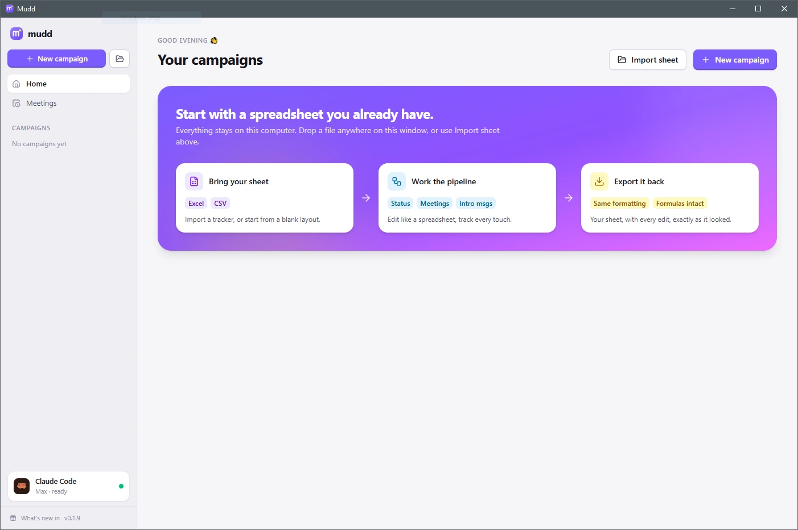
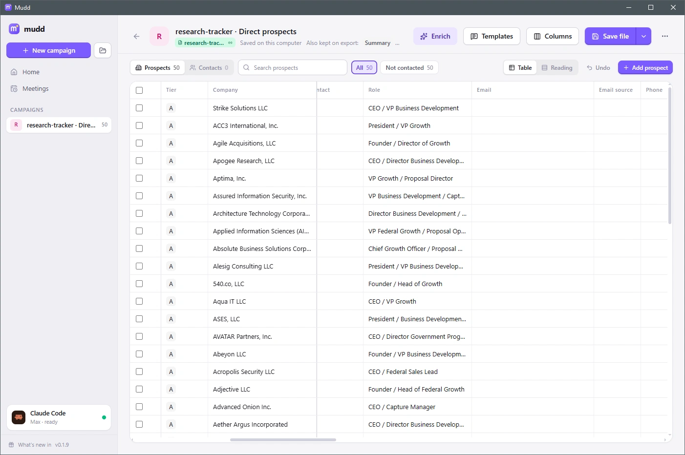
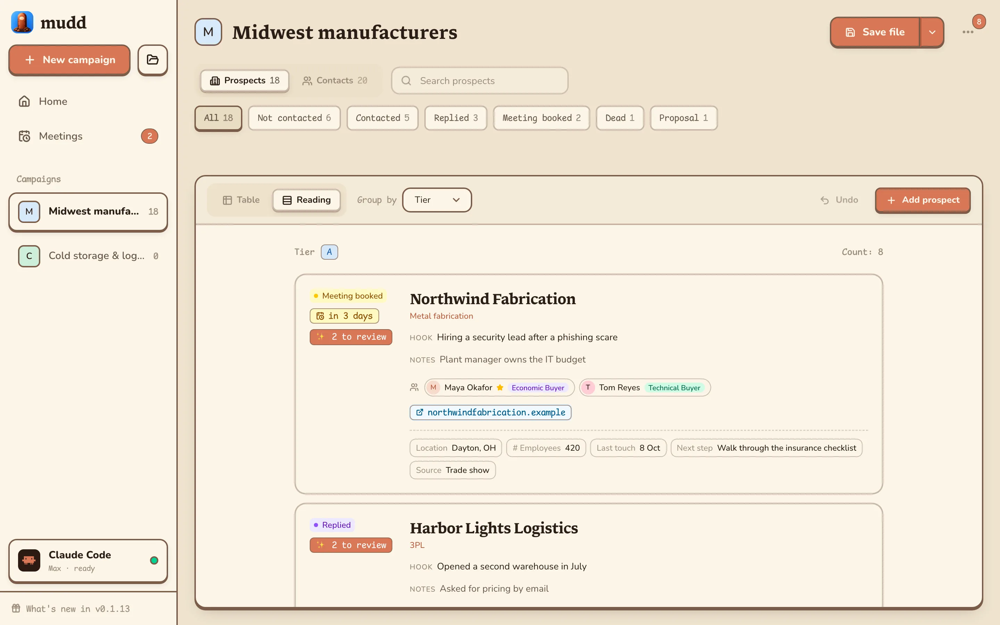
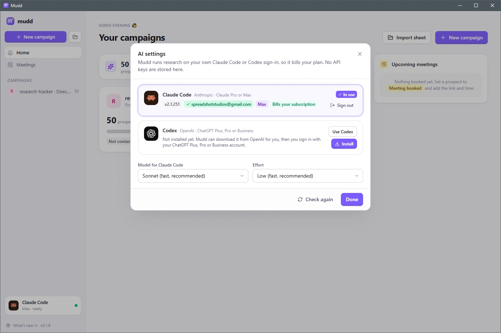

# Mudd

**A free desktop CRM for sales prospecting that works on the spreadsheet you already have.**

Open your Excel or CSV lead tracker in Mudd and work it like a CRM. Track each company and its contacts through your pipeline, let AI research the gaps and draft personal intros, then save straight back to the same file. Your formatting, formulas and other tabs are kept, so the spreadsheet stays the source of truth.

- **AI enrichment with sources**: Mudd researches each prospect on the web and fills columns you choose, such as industry, headcount or a decision-maker's name. Every suggestion links to its source, and you accept or reject it.
- **Intros that sound like you**: write templates with `{{First name}}`-style placeholders, and AI fills them in with one or two real, checkable hooks per prospect.
- **Private by design**: your data stays on your computer. There's no account, no cloud service and no API key. The AI runs through your own Claude Code or Codex sign-in and bills the plan you already pay for.
- **Free**: for Windows, macOS and Linux.



<table>
  <tr>
    <th width="50%">Edit like a spreadsheet</th>
    <th width="50%">Or read it prospect by prospect</th>
  </tr>
  <tr>
    <td width="50%"></td>
    <td width="50%"></td>
  </tr>
</table>

## Setup

```powershell
bun install          # first time only
bun run start        # opens the Mudd window
```

## Quickstart

| Command             | What it does                                                                                |
| ------------------- | ------------------------------------------------------------------------------------------- |
| `bun run start`     | The app in its own window (webview-bun).                                                    |
| `bun run headless`  | Server only. Open the printed `http://127.0.0.1:24871` in a browser.                        |
| `bun run dev`       | Browser dev server with hot reload on `http://127.0.0.1:3000`.                              |
| `bun run build`     | Standalone `dist/Mudd.exe` (a `Mudd.app` on macOS).                                         |
| `bun run icon`      | Rebuild `assets/icon.ico` from `assets/icon.svg` (needs Edge or Chrome). Commit the result. |
| `bun run typecheck` | TypeScript check.                                                                           |
| `bun test`          | Unit and round-trip tests (see below).                                                      |

Your campaigns are stored in `%APPDATA%\Mudd\mudd.sqlite`. Set `MUDD_DATA_DIR` to use a different folder.

## Releases

Bump `version` in package.json, then run **Actions → Manual Release → Run workflow**, picking the branch to build (no other input: the release is tagged `v<version>`, e.g. `v0.1.4`). It builds a zip for Windows x64, Linux x64 and macOS (Apple silicon and Intel; the zip holds `Mudd.app`), the same file people download and Mudd updates itself from, and, only if all four succeed, attaches them to a **draft** release. Publish the draft from the Releases page when you're ready; that creates the tag if it doesn't exist yet. The builds are unsigned (macOS is ad-hoc signed), so Windows and macOS warn on first launch.

**Updates.** Publishing a release is also what updates everyone. Mudd asks GitHub for the latest release of `dieharders/mudd-gtm-crm` when it opens and every 6 hours after, and when it's newer, offers it in the sidebar. **Update & restart** downloads this platform's zip, checks it against the SHA-256 GitHub lists for it, swaps it in for the running copy and restarts. That check is the only request Mudd makes on its own, and none of your data goes with it. Where Mudd can't replace itself (run from source, or from a folder it can't write to), the sidebar links to the download instead. Code: `src/server/update.ts`.

## How it works

- **Campaign** = a list of prospects (companies), each with its own contacts (people), read from two tabs of a workbook: **Prospects** and **Contacts**. Every prospect has an ID (`P-001`…); each row of the Contacts tab names its prospect by that ID in a `Prospect ID` column, so renaming a company never loses its people (a `Company` column there is kept in step, for reading).
- **Contacts** have a `Contact type` (Economic Buyer, Technical Buyer, End User, Influencer, Blocker, Gatekeeper) and a `Primary` box: the primary contact is the one intros, templates (`{{First name}}`) and AI research address. The prospect panel lists a prospect's contacts and opens each one; the Contacts tab of the app lists everyone.
- **Import** (.xlsx, .csv, .tsv or .txt; not .xlsm, whose macros a save would lose): pick the prospects tab when the workbook has several; a tab named `Contacts` is read as their people (a row whose Prospect ID matches nothing is left in the file as it is). Every other tab stays in the file untouched; a tab that looks like an old Screened-out list is ignored. A tab with formulas can't be imported (writing into it would break them). Importing with the **Import** button remembers the file's path, so **Save file** writes straight back to it.
- **Remove from Mudd** (the "…" menu on a campaign's card or in its header) takes the campaign out of the app only. The spreadsheet it came from or saves to, and Mudd's backups of it, are never deleted; import the file again to bring it back as last saved.
- **Screening out** ticks the prospect's `Screened out` column (with an optional `Screened reason`). The prospect stays where it is in the list and in the sheet, disabled in the app until you restore it.
- **Pipeline**: the sheet's own Status column drives the stepper (Not contacted → Contacted → Replied → Meeting booked → … → Signed, or Dead). Moving a prospect, in the panel or the grid, fills empty `Sent` / `Replied` dates and updates `Last touch`.
- **Mudd adds** `Meeting URL`, `Meeting at`, `Intro message`, `Screened out`, `Screened reason` and `ID` columns when the sheet lacks them, and a Contacts tab once there are contacts. They go **after the last column the sheet uses**, so formulas pointing at existing columns keep working.
- **Templates**: per-campaign intro messages with `{{Column}}`, `{{First name}}` and `{{Column|fallback}}` placeholders. They're saved into an `Intro templates` tab and restored on re-import.
- **Save file** writes into the workbook you imported, in place: only the cells you changed are rewritten (each keeping its format); a deleted prospect's row is blanked, never removed, so nothing below it moves; new prospects go under the data. Every other part of the file (other tabs, charts, notes, SharePoint properties) is kept byte for byte. Mudd asks before replacing a file that was changed outside it, keeps the previous version as a `.bak.xlsx` next to it, and the last ten versions under `backups/` in its data folder. When Mudd doesn't know where the file is (dropped in, a CSV, created in Mudd), it saves to Downloads and keeps saving there. **Save to cloud** (SharePoint) is coming.

## Tests

```powershell
$env:MUDD_FIXTURE = "C:\Users\you\Downloads\base-tracker.xlsx"; bun test
```

The round-trip suite builds workbooks with the features real trackers have (formulas on another tab, column formats, notes, merges, dropdowns, tables) and checks what a save keeps. It can also read your own tracker from `MUDD_FIXTURE`, rather than from a copy in the repo, because a tracker contains real contact details.

## Layout

```
main.ts                 native window + server worker
src/worker.ts           Bun.serve on 127.0.0.1
src/server/             REST API, SQLite, native file dialogs
src/xlsx/               import (ExcelJS), export (patches the workbook's XML in place)
src/shared/             types and template merging (client + server)
src/client/             React UI (Tailwind v4, lucide-react, react-hot-toast)
```

## AI: Enrichment and intro messages

Mudd drives **your own signed-in agent CLI**. It never stores an API key, and research bills your plan.

Already pay for Claude Pro or Max, or ChatGPT Plus, Pro or Business? Mudd uses that subscription. Sign in once in **AI settings** and it shows which account is in use and that research bills your subscription, not a pay-per-use API key.



| Provider              | Needs                                      | Sign in                                             |
| --------------------- | ------------------------------------------ | --------------------------------------------------- |
| Claude Code (default) | `npm install -g @anthropic-ai/claude-code` | `claude auth login` (or **Sign in** in AI settings) |
| Codex                 | `npm install -g @openai/codex`             | `codex login`                                       |

Open **AI settings** from the bottom of the sidebar to pick the provider, model and effort. It shows the signed-in account and whether usage bills your subscription or an API key. "Bill my Claude subscription only" removes `ANTHROPIC_API_KEY` from the CLI's environment. It is switched off automatically if that key is your only credential.

**What a research turn can do.** Claude Code gets `WebSearch` and `WebFetch` and nothing else: no shell, no file access. It runs in an empty scratch folder, with your CLAUDE.md, hooks and MCP servers ignored, and with no saved session. Codex runs `exec` with a read-only sandbox. Nothing leaves the machine until you press Run, and the first run asks for consent.

- **Enrich** (campaign toolbar): pick a preset or write a recipe.
  - A recipe is what to find, which columns to send, and which columns to fill. It targets existing columns when the headers match, otherwise it appends new ones.
  - Presets: Company snapshot, Recent news & trigger, Decision-maker, Published email (the domain's mail server is checked), Personalization hook.
  - **Test on 3 rows**, then **Run** on the selection, on rows missing the fields, or on everything.
  - Runs have pause, resume and stop, choose how many rows run at once, and retry failed rows automatically.
- **Review**: every finding is a suggestion, with its source link and a confidence level.
  - Accepting writes the cell (with undo) and adds the link to an `Enrichment sources` column.
  - "Fill empty cells automatically" skips review only for cells that are empty.
  - A violet dot on a cell means it has a suggestion waiting.
- **Write with AI** (prospect panel → Intro message): let the AI pick the best-fitting template, or choose one.
  - It fills the placeholders, researches 1–2 verifiable hooks and shows a draft with those sources. Use it, try again, or discard it.
  - **Draft intros** in the bulk bar does the same for every selected row.

Code: `src/server/ai/` (providers, discovery, environment, structured turns), `src/server/enrich/` (runner, prompts, storage, event stream), and `src/client/components/{ai,enrich}/`.

## License

Copyright (C) 2026 dieharders

Mudd is licensed under the [GNU Affero General Public License v3.0](LICENSE) only (`AGPL-3.0-only`). Use it for anything, including at work, and change and share it. Anything you share that's built from Mudd, in whole or in part, must be under the same license with its complete source, and so must a changed Mudd that you run as a service for others. Provided as is, without warranty.

**Additional permission under GNU AGPL version 3 section 7:** if you modify this program, or any covered work, by linking or combining it with Anthropic's Claude Agent SDK (`@anthropic-ai/claude-agent-sdk`), containing parts covered by the terms of Anthropic's own license, the licensors of this program grant you additional permission to convey the resulting work. Mudd's builds include that SDK, which is not free software; its source is not part of Mudd's Corresponding Source.
