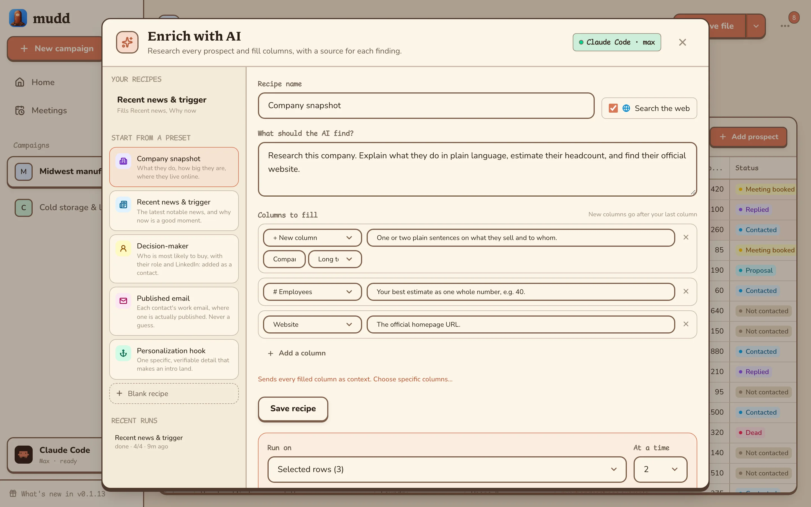
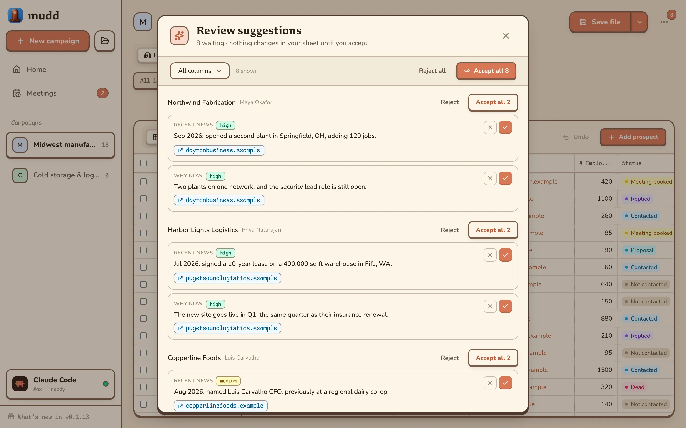
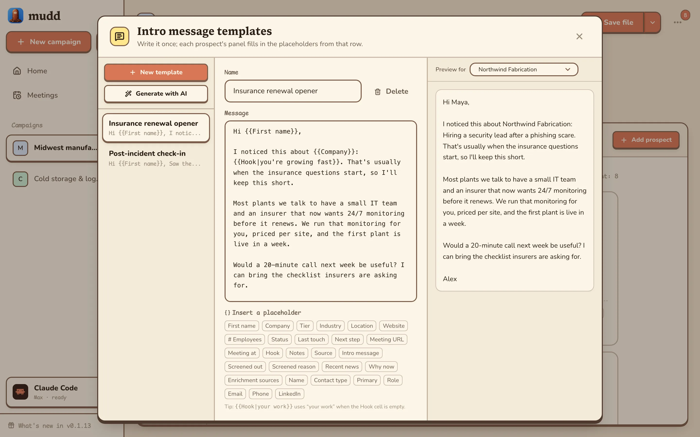
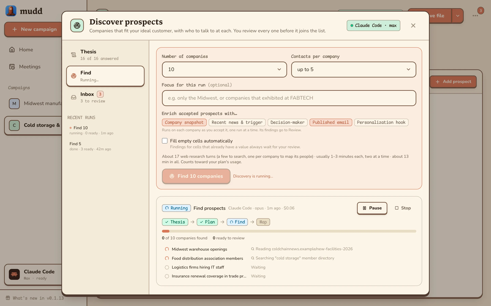
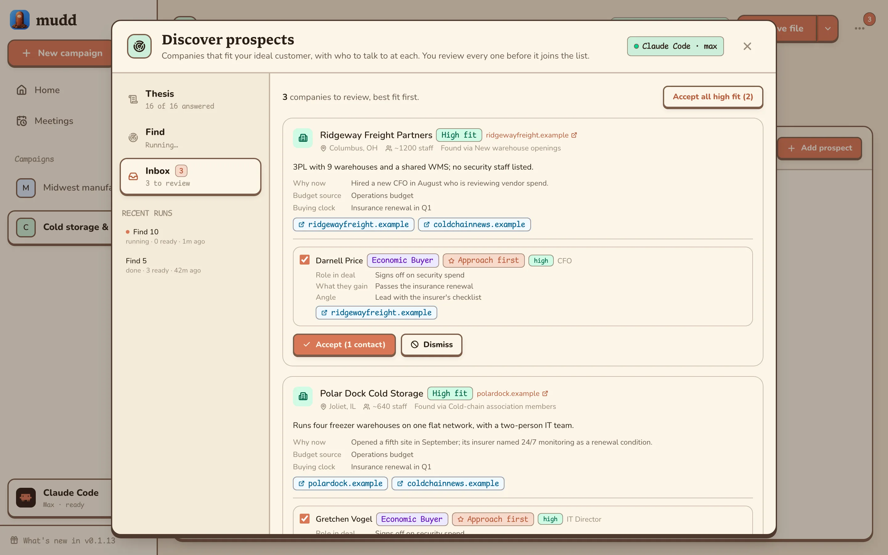

<h1> Mudd (Mud-dee)</h1>

**Don't let your go-to-market strategy get stuck in the mud.**

Mudd is a free, all-in-one desktop app to manage relationships and sales prospecting. It is a necessary tool for taking your product or service to market.

Search for and find new cold prospects and their contact information for free using your own AI agent. Track your relationships and chart your sales course for each prospect.

Open your Excel or CSV lead tracker in Mudd and edit it like a CRM. Track each company and its contacts through your pipeline, let AI research the gaps and draft personal intros. The spreadsheet acts as the source of truth.

- **AI enrichment with sources**: Mudd researches each prospect on the web and fills columns you choose, such as industry, headcount or a decision-maker's name. Every suggestion links to its source, and you accept or reject it.
- **Intros that sound like you**: write templates with `{{First name}}`-style placeholders, and AI fills them in for each person around one real, checkable hook per prospect.
- **Private by design**: your data stays on your computer. There's no account, no cloud service and no API key. The AI runs through your own Claude Code or Codex sign-in and bills the plan you already pay for.
- **Free**: for Windows, macOS and Linux.


<table>
  <tr>
    <th width="50%">Edit like a spreadsheet</th>
    <th width="50%">Or read as a list</th>
  </tr>
  <tr>
    <td width="50%"></td>
    <td width="50%"></td>
  </tr>
</table>

## Setup

```powershell
bun install          # first time only
bun run start        # opens the Mudd window
```

## Quickstart

| Command               | What it does                                                                                                      |
| --------------------- | ----------------------------------------------------------------------------------------------------------------- |
| `bun run start`       | The app in its own window (webview-bun).                                                                          |
| `bun run headless`    | Server only. Open the printed `http://127.0.0.1:24871` in a browser.                                              |
| `bun run dev`         | Browser dev server with hot reload on `http://127.0.0.1:3000`.                                                    |
| `bun run build`       | Standalone `dist/Mudd.exe` (a `Mudd.app` on macOS).                                                               |
| `bun run icon`        | Rebuild `assets/icon.ico` from `assets/icon.png` (needs Edge or Chrome). Commit the result.                       |
| `bun run screenshots` | Retake the README images in `docs/screenshots/` from made-up demo data (needs Edge or Chrome). Commit the result. |
| `bun run typecheck`   | TypeScript check.                                                                                                 |
| `bun test`            | Unit and round-trip tests (see below).                                                                            |

App data is stored in `%APPDATA%\Mudd\mudd.sqlite`. Set `MUDD_DATA_DIR` to use a different folder.

## How it works

A campaign is a workbook you import (.xlsx, .csv or .tsv): its Prospects tab holds the companies and its Contacts tab their people, linked by a Prospect ID. Mudd adds the columns it needs (Status, ID, Screened out and the like) after the last column your sheet uses, then you work the list in the app: move each prospect through the pipeline from Not contacted to Signed, let AI research the gaps and draft intros from your templates, and screen out the ones that don't fit. **Save file** writes only the cells you changed back into the original workbook, leaving everything else in it untouched and keeping backups of earlier versions.

## File Layout

```
main.ts                 native window + server worker
src/worker.ts           Bun.serve on 127.0.0.1
src/server/             REST API, SQLite, native file dialogs
src/xlsx/               import (ExcelJS), export (patches the workbook's XML in place)
src/shared/             types and template merging (client + server)
src/client/             React UI (Tailwind v4, lucide-react, react-hot-toast)
```

## Using AI

Mudd drives **your own signed-in agent CLI**. It never stores an API key, and research bills your plan.


| Provider              | Needs                                      | Sign in                                             |
| --------------------- | ------------------------------------------ | --------------------------------------------------- |
| Claude Code (default) | `npm install -g @anthropic-ai/claude-code` | `claude auth login` (or **Sign in** in AI settings) |
| Codex                 | `npm install -g @openai/codex`             | `codex login`                                       |

Open **AI settings** from the bottom of the sidebar to pick the provider, model and effort. It shows the signed-in account.

**What a research turn can do.** Claude Code gets `WebSearch` and `WebFetch` and nothing else: no shell, no file access. It runs in an empty scratch folder, with your CLAUDE.md, hooks and MCP servers ignored, and with no saved session. Codex runs `exec` with a read-only sandbox. Nothing leaves the machine until you press Run, and the first run asks for consent.

### Enrichment

- **Enrich** (selection bar, shown when rows are selected): pick a preset or write a recipe.
  - A recipe is what to find, which columns to send, and which columns to fill. It targets existing columns when the headers match, otherwise it appends new ones.
  - Presets: Company snapshot, Recent news & trigger, Decision-maker, Published email (the domain's mail server is checked), Personalization hook.
  - **Test on 3 rows**, then **Run** on the selection, on rows missing the fields, or on everything.
  - Runs have pause, resume and stop, choose how many rows run at once, and retry failed rows automatically.



- **Review**: every finding is a suggestion, with its source link and a confidence level.
  - Accepting writes the cell (with undo) and adds the link to an `Enrichment sources` column.
  - "Fill empty cells automatically" skips review only for cells that are empty.
  - A violet dot on a cell means it has a suggestion waiting.



### Outbound templates



- **Write with AI** (prospect panel → a contact → Intro message): let the AI pick the best-fitting template, or choose one. Each contact gets their own intro, one at a time: intros are never drafted in bulk, and enrichment never writes them.
  - It fills the placeholders around the prospect's `Hook` and shows a draft with its source. Use it, try again, or discard it.
  - A prospect has one hook for all its people. With none yet, the first intro researches one verifiable hook, which waits for review as the prospect's `Hook` (using the draft accepts it too) and is what the intros to its other people are built on. A campaign without a `Hook` column gets one.
  - A contact can't be deleted while their intro is being written.

### Discover

Start a campaign with **Discover prospects** and Mudd finds companies that fit your ideal customer, with who to talk to at each. You review every one before it joins the list.



- **Thesis**: sixteen questions about who you sell to. The first two are required; **Fill blanks with AI** drafts the rest.
- **Find**: pick how many companies and contacts per company, add a focus for this run, and choose which enrichments run on each company you accept. The run plans a few search angles, searches them two at a time, then maps each company's buying committee.
- **Inbox**: each candidate shows why it fits, why now, and the page it was found on. Accept adds it (and its contacts) as prospects; dismiss with a reason, and later runs avoid that kind.



## License

Copyright (C) 2026 OpenBrew.ai

Mudd is licensed under the [GNU Affero General Public License v3.0](LICENSE) only (`AGPL-3.0-only`). Use it for anything, including at work, and change and share it. Anything you share that's built from Mudd, in whole or in part, must be under the same license with its complete source, and so must a changed Mudd that you run as a service for others. Provided as is, without warranty.

**Additional permission under GNU AGPL version 3 section 7:** if you modify this program, or any covered work, by linking or combining it with Anthropic's Claude Agent SDK (`@anthropic-ai/claude-agent-sdk`), containing parts covered by the terms of Anthropic's own license, the licensors of this program grant you additional permission to convey the resulting work. Mudd's builds include that SDK, which is not free software; its source is not part of Mudd's Corresponding Source.
